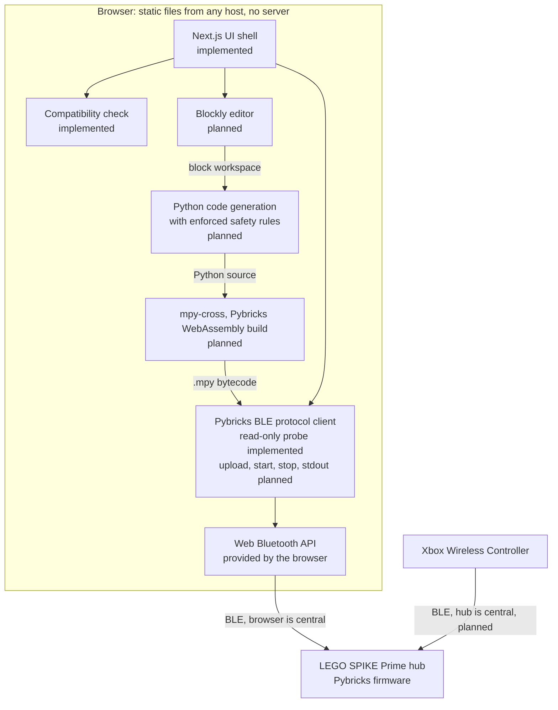

# Architecture

MatPilot is a static web app. Everything (block editing, Python generation, compilation to
MicroPython bytecode, and Bluetooth communication) runs in the user's browser. There is no server
([ADR 0001](adr/0001-browser-only-web-bluetooth.md), [ADR 0002](adr/0002-static-export-no-server-features.md)).

Components marked **planned** do not exist yet. See the [roadmap](roadmap.md).

## Layers



The same layers as text, top to bottom:

```
Browser (static files, no server)
  Blockly editor ............................ planned
    -> Python code generation ............... planned
      -> mpy-cross (WebAssembly) ............ planned
        -> Pybricks BLE protocol client ..... read-only probe implemented;
           (src/lib/ble, src/lib/pybricks)    upload/start/stop/stdout planned
          -> Web Bluetooth (browser API)
            -> LEGO SPIKE Prime hub (Pybricks firmware)

Hub-direct gamepad path (planned)
  Xbox Wireless Controller -> SPIKE Prime hub   (hub is the BLE central;
                                                 the browser is not in the loop)
```

### Program path (planned)

1. **Blockly editor:** the user builds a program from blocks.
2. **Python code generation:** blocks become Pybricks MicroPython source. The generator enforces
   the hub code rules in [CLAUDE.md](../CLAUDE.md) (main loop in `try`/`finally` that stops every
   motor, `OSError` handling around controller reads, one config block for tuning constants, no
   hardcoded ports inside logic).
3. **mpy-cross (WebAssembly):** the MicroPython cross-compiler, in Pybricks' published WebAssembly
   build ([ADR 0006](adr/0006-adopt-pybricks-mpy-cross.md)), turns the source
   into `.mpy` bytecode in the browser. Its output must match `pybricksdev` byte for byte (golden
   tests).
4. **Pybricks BLE protocol client:** uploads the program, starts and stops it, and streams stdout.
   The protocol is documented, with citations, in [protocol/pybricks-ble.md](protocol/pybricks-ble.md).

### Hub-direct gamepad path (planned)

An Xbox controller connects to the hub, not to the browser. The hub program uses Pybricks'
`XboxController` class, and the hub acts as the Bluetooth central that scans for and connects to the
controller ([ADR 0003](adr/0003-hub-direct-gamepad.md)). The browser starts the program and may show
telemetry, but it is never in the control loop.

## What exists today

| Component           | Location                      | Notes                                                              |
| ------------------- | ----------------------------- | ------------------------------------------------------------------ |
| UI shell            | `src/app/`, `src/components/` | Static pages `/` and `/hardware-test`; React client components     |
| React bindings      | `src/hooks/`                  | The only place React touches `src/lib/`                            |
| Compatibility check | `src/lib/compat/`             | Pure evaluation plus a collector for browser globals               |
| Hub probe           | `src/lib/ble/`                | Framework-agnostic state machine; read-only by its types           |
| Hardware test       | `src/lib/hwtest/`             | Session recorder, step logic, and plain-text report; no new BLE    |
| Pybricks constants  | `src/lib/pybricks/`           | UUIDs and version parsing, each cited to an upstream commit        |
| Export guard        | `scripts/verify-export.mjs`   | Fails the build without `out/index.html` or with third-party loads |

### Hub probe flow

```
click "Connect to hub"  (user gesture)
  -> navigator.bluetooth.requestDevice({
       filters: [{ services: [Pybricks service UUID] }],
       optionalServices: [Device Information 0x180A] })
       - user cancels                -> "No hub selected" (not an error)
       - blocked / no adapter        -> error state
  -> device.gatt.connect()
  -> Device Information service
       -> read Firmware Revision String (0x2A26), e.g. "4.0.1"
       -> read Software Revision String (0x2A28), the Pybricks protocol version, e.g. "1.5.0"
  -> "Connected": device name (BluetoothDevice.name), firmware, protocol version
  -> gattserverdisconnected without a user request -> "Hub disconnected"
```

The probe never writes a characteristic and never calls `startNotifications()` (which writes a
descriptor). Its GATT interfaces in `src/lib/ble/hub-probe.ts` declare no write methods, so a write
does not compile.

## Boundaries enforced in code

| Rule                                    | Enforcement                                                                                                                  |
| --------------------------------------- | ---------------------------------------------------------------------------------------------------------------------------- |
| Static export only                      | `output: 'export'` in `next.config.ts`; `scripts/verify-export.mjs`                                                          |
| No third-party origins at runtime       | `verify-export.mjs` scans exported HTML/CSS; production pages carry a `Content-Security-Policy` meta tag limited to `'self'` |
| UI does not call Web Bluetooth directly | ESLint `no-restricted-properties` on `navigator.bluetooth` in `src/app`, `src/components`, `src/hooks`                       |
| `src/lib/` stays framework-agnostic     | ESLint `no-restricted-imports` bans React and Next.js in `src/lib/`                                                          |
| Hub probe is read-only                  | GATT types expose only `readValue()`; unit tests assert no writes                                                            |
