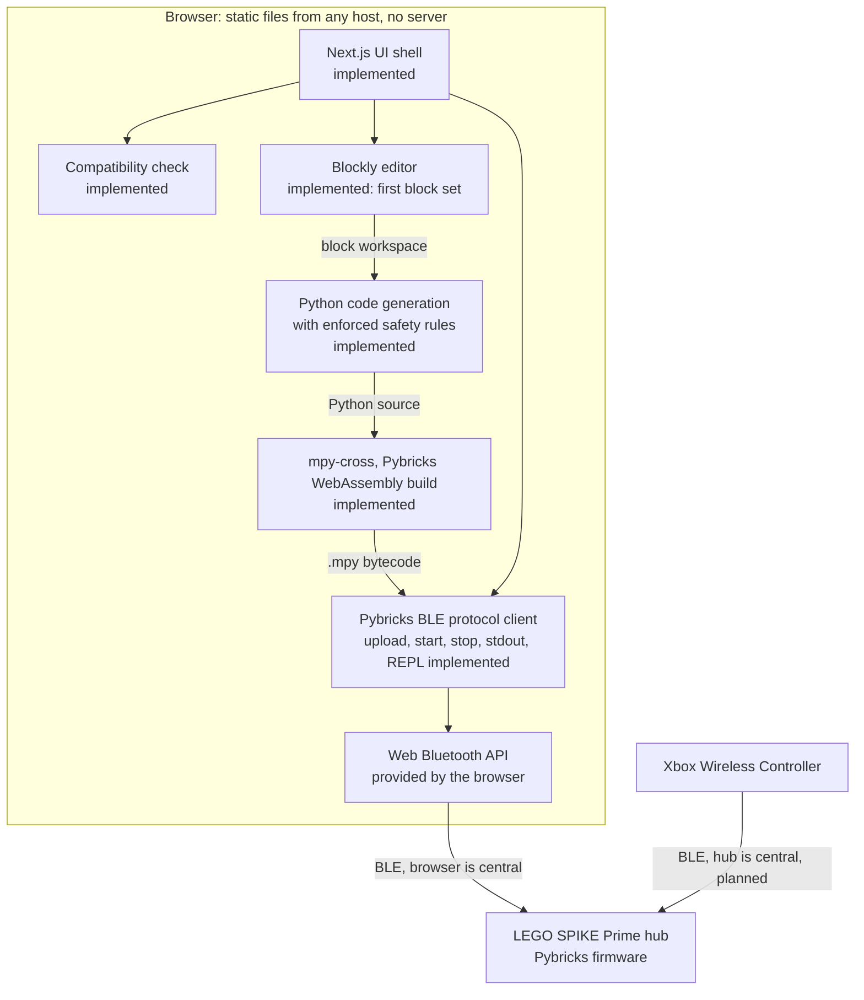

# Architecture

MatPilot is a static web app. Everything (block editing, Python generation, compilation to
MicroPython bytecode, and Bluetooth communication) runs in the user's browser. There is no server
([ADR 0001](adr/0001-browser-only-web-bluetooth.md), [ADR 0002](adr/0002-static-export-no-server-features.md)).

Components marked **planned** do not exist yet. See the [roadmap](roadmap.md).

## Layers



The same layers as text, top to bottom:

```
Browser (static files, no server)
  Blockly editor ............................ implemented (ADR 0008), first block set
    -> Python code generation ............... implemented (src/lib/blocks)
      -> mpy-cross (WebAssembly) ............ implemented (ADR 0006)
        -> Pybricks BLE protocol client ..... implemented: probe (read-only) and
           (src/lib/ble, src/lib/pybricks)    connection (upload/start/stop/stdout)
          -> Web Bluetooth (browser API)
            -> LEGO SPIKE Prime hub (Pybricks firmware)

Hub-direct gamepad path (planned)
  Xbox Wireless Controller -> SPIKE Prime hub   (hub is the BLE central;
                                                 the browser is not in the loop)
```

### Program path

1. **Blockly editor** (`/blocks`, [ADR 0008](adr/0008-block-editor.md)): the user builds a
   program from blocks. Each block is one Pybricks call. A "set up" block names each device and
   its port. The Python program written directly on `/program` skips steps 1 and 2.
2. **Python code generation** (`src/lib/blocks/generator.ts`): blocks become Pybricks
   MicroPython source with a fixed shape that enforces the hub code rules in
   [CLAUDE.md](../CLAUDE.md):
   - ports in one Config section, and no hardcoded ports inside logic;
   - the main program in `try`/`finally`, stopping every motor.

   `OSError` handling around controller reads arrives with the controller blocks (milestone 5).
   Problems such as a device used but not set up disable Run.

3. **mpy-cross (WebAssembly):** the MicroPython cross-compiler, in Pybricks' published WebAssembly
   build ([ADR 0006](adr/0006-adopt-pybricks-mpy-cross.md)), turns the source
   into `.mpy` bytecode in the browser. Its output must match `pybricksdev` byte for byte (golden
   tests).
4. **Pybricks BLE protocol client:** uploads the program, starts and stops it, and streams stdout.
   The protocol is documented, with citations, in [protocol/pybricks-ble.md](protocol/pybricks-ble.md).

### Live device values path

On `/blocks`, while the hub is connected and no user program runs, `useLiveDevices` asks
`HubConnection.runInRepl()` to start the hub's REPL and paste a small reader into it
([ADR 0009](adr/0009-live-device-values.md), [protocol section 8](protocol/pybricks-ble.md#8-repl-sessions-live-device-values)).
The reader prints one `@mpv` line per reading; `src/lib/devices/live.ts` parses them for the device
bar, and they never reach the Monitor. Run stops the REPL before uploading, and the reader starts
again when the program ends. Nothing is written to a program slot.

### Hub-direct gamepad path (planned)

An Xbox controller connects to the hub, not to the browser. The hub program uses Pybricks'
`XboxController` class, and the hub acts as the Bluetooth central that scans for and connects to the
controller ([ADR 0003](adr/0003-hub-direct-gamepad.md)). The browser starts the program and may show
telemetry, but it is never in the control loop.

## What exists today

| Component           | Location                                 | Notes                                                                                                                         |
| ------------------- | ---------------------------------------- | ----------------------------------------------------------------------------------------------------------------------------- |
| UI shell            | `src/app/`, `src/components/`            | Static pages; `(site)` pages have the site header and footer, `(studio)` pages (`/blocks`) fill the window                    |
| React bindings      | `src/hooks/`                             | The only place React touches `src/lib/`                                                                                       |
| Compatibility check | `src/lib/compat/`                        | Pure evaluation plus a collector for browser globals                                                                          |
| Hub probe           | `src/lib/ble/`                           | Framework-agnostic state machine; read-only by its types                                                                      |
| Hardware test       | `src/lib/hwtest/`                        | Session recorder, step logic, and plain-text report; no new BLE                                                               |
| Hub connection      | `src/lib/ble/hub-connection.ts`          | Upload, start, stop, stdin, stdout, REPL sessions; the only module that writes ([ADR 0007](adr/0007-ble-transport-writes.md)) |
| Compiler            | `src/lib/pybricks/compiler.ts`, `mpy.ts` | Pybricks' mpy-cross WebAssembly build, self-hosted ([ADR 0006](adr/0006-adopt-pybricks-mpy-cross.md))                         |
| Monitor and plotter | `src/lib/monitor/`                       | Stream decoding, bounded log, Arduino-style plot parsing                                                                      |
| Block editor        | `src/lib/blocks/`                        | Blockly blocks, toolbox, themes, and the Python generator ([ADR 0008](adr/0008-block-editor.md))                              |
| Live device values  | `src/lib/devices/`                       | The reader pasted into the hub's REPL, and its line parser ([ADR 0009](adr/0009-live-device-values.md))                       |
| Pybricks constants  | `src/lib/pybricks/`                      | UUIDs and version parsing, each cited to an upstream commit                                                                   |
| Export guard        | `scripts/verify-export.mjs`              | Fails the build without `out/index.html` or with third-party loads                                                            |

### Hub probe flow

```
click "Connect to hub"  (user gesture)
  -> navigator.bluetooth.requestDevice({
       filters: [{ services: [Pybricks service UUID] }],
       optionalServices: [Device Information 0x180A] })
       - user cancels                -> "No hub selected" (not an error)
       - blocked / no adapter        -> error state
  -> device.gatt.connect()
  -> Device Information service
       -> read Firmware Revision String (0x2A26), e.g. "4.0.1"
       -> read Software Revision String (0x2A28), the Pybricks protocol version, e.g. "1.5.0"
  -> "Connected": device name (BluetoothDevice.name), firmware, protocol version
  -> gattserverdisconnected without a user request -> "Hub disconnected"
```

The probe never writes a characteristic and never calls `startNotifications()` (which writes a
descriptor). Its GATT interfaces in `src/lib/ble/hub-probe.ts` declare no write methods, so a write
does not compile.

## Boundaries enforced in code

| Rule                                    | Enforcement                                                                                                                  |
| --------------------------------------- | ---------------------------------------------------------------------------------------------------------------------------- |
| Static export only                      | `output: 'export'` in `next.config.ts`; `scripts/verify-export.mjs`                                                          |
| No third-party origins at runtime       | `verify-export.mjs` scans exported HTML/CSS; production pages carry a `Content-Security-Policy` meta tag limited to `'self'` |
| UI does not call Web Bluetooth directly | ESLint `no-restricted-properties` on `navigator.bluetooth` in `src/app`, `src/components`, `src/hooks`                       |
| `src/lib/` stays framework-agnostic     | ESLint `no-restricted-imports` bans React and Next.js in `src/lib/`                                                          |
| Hub probe is read-only                  | GATT types expose only `readValue()`; unit tests assert no writes                                                            |
| One module writes to the hub            | `HubConnection` only; unit tests check write order, chunk size, one write in flight, and STOP before disconnect              |
| WebAssembly only from this site         | CSP `script-src` adds `'wasm-unsafe-eval'` (no JS eval); `verify-export.mjs` requires `out/vendor/mpy-cross-v6.wasm`         |
