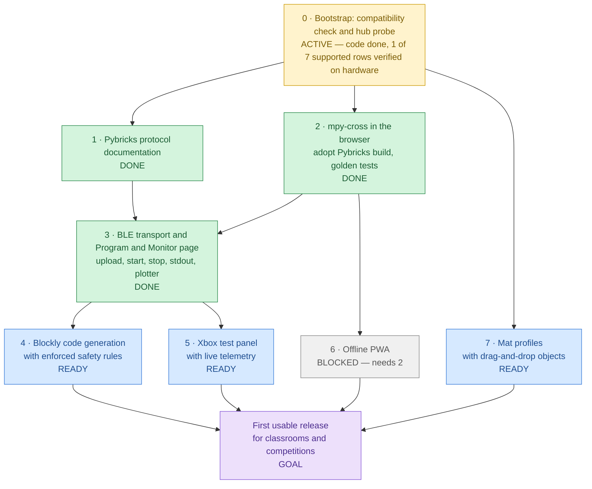

# Roadmap

Last reviewed: 2026-11-05

## At a glance

Milestone numbers are the planned order of work. Arrows are hard technical dependencies: a milestone
cannot be finished before the milestones that point to it.

| Milestone                        | Status     | What it is                                                                                                                                                                                            | Blocker                                                                                                                                                  |
| -------------------------------- | ---------- | ----------------------------------------------------------------------------------------------------------------------------------------------------------------------------------------------------- | -------------------------------------------------------------------------------------------------------------------------------------------------------- |
| **0 · Bootstrap**                | 🟡 ACTIVE  | Static Next.js app, Docker toolchain, CI, docs, ADRs, compatibility check, read-only hub probe, hardware test page                                                                                    | Hardware verification of the other 6 supported rows (Chrome on macOS verified 2026-11-04; [checklist](compatibility.md#how-to-verify-a-row-on-hardware)) |
| **1 · Pybricks protocol docs**   | ✅ DONE    | [`docs/protocol/pybricks-ble.md`](protocol/pybricks-ble.md): capabilities, commands, events, program format and upload sequence, every statement cited to an upstream commit                          | —                                                                                                                                                        |
| **2 · mpy-cross in the browser** | ✅ DONE    | Adopt Pybricks' `@pybricks/mpy-cross-v6` WebAssembly build ([ADR 0006](adr/0006-adopt-pybricks-mpy-cross.md)); golden tests prove byte-for-byte identical output to `pybricksdev` for the same source | — (goldens byte-identical; the `.wasm` loads from this site under the CSP)                                                                               |
| **3 · BLE transport**            | ✅ DONE    | Upload a compiled program, start and stop it, stream stdout, in `src/lib/ble/`; Program and Monitor page with text monitor and plotter                                                                | — (9 of 9 [hardware checks](compatibility.md#program-and-monitor-results) passed 2026-11-05)                                                             |
| **4 · Blockly code generation**  | 🔵 READY   | Blockly editor that generates Pybricks MicroPython and enforces the hub code rules (`try`/`finally` motor stop, `OSError` handling, config block, no hardcoded ports)                                 | None: 3 is done, and Stop was verified to stop the program on a hub                                                                                      |
| **5 · Xbox test panel**          | 🔵 READY   | Ships a hub program that reads an Xbox controller (hub-direct, [ADR 0003](adr/0003-hub-direct-gamepad.md)) and shows its live telemetry in the browser                                                | None technically (3 is done); scheduled after 4. Independent of 4                                                                                        |
| **6 · Offline PWA**              | ⬜ BLOCKED | Service worker and manifest so the app, including the WebAssembly compiler, works without a network                                                                                                   | Needs 2 (the compiler must be cacheable to compile offline)                                                                                              |
| **7 · Mat profiles**             | 🔵 READY   | Mat profiles with drag-and-drop objects, all in millimetres ([ADR 0004](adr/0004-millimetre-units.md))                                                                                                | None technically; scheduled last by priority                                                                                                             |
| **Goal: first usable release**   | 🟪 GOAL    | Students program a robot with blocks, run it on a hub, drive it with a controller, and use the app offline                                                                                            | Needs 4, 5, 6 and 7                                                                                                                                      |

**The real bottleneck is hardware access.** Hardware verification (a real SPIKE Prime hub on each
supported browser and platform) gates milestone 0 and every BLE feature; it cannot be replaced by
unit tests. Milestone 3, the only join on the critical path, is done (verified on a hub
2026-11-05), so milestones 4, 5 and 7 can all proceed; 4 is next by priority.

## Milestones in planned order

### 0 · Bootstrap (this release)

Repository, CI, documentation, ADRs, and the first feature: a compatibility check and a read-only
hub probe that reads the device name, firmware revision, and protocol version. A hardware test page
(`/hardware-test`) guides the hardware checks and produces a report. Verified so far: Google Chrome
on macOS (2026-11-04, Pybricks 4.0.1, all five steps). Remaining: the other six supported rows
(Chrome and Edge on Windows, Edge on macOS, Chrome on ChromeOS, Chrome and Edge on Android),
recorded in [compatibility.md](compatibility.md).

### 1 · Pybricks protocol documentation (done)

[`docs/protocol/pybricks-ble.md`](protocol/pybricks-ble.md) describes every part of the Pybricks BLE
protocol MatPilot uses (capabilities, commands, events, status flags, the program format, and the
upload sequence). Each statement has a permalink to the upstream source at Pybricks v4.0.1 and
pybricksdev v2.3.2, and the protocol version each feature first appeared in.

### 2 · mpy-cross in the browser with golden tests

Adopt Pybricks' published WebAssembly build of the MicroPython cross-compiler,
`@pybricks/mpy-cross-v6`, served from MatPilot's own origin
([ADR 0006](adr/0006-adopt-pybricks-mpy-cross.md)). Golden tests compile a corpus of programs with
both the browser build and `pybricksdev`, and require byte-for-byte identical output.

### 3 · BLE transport, and the Program and Monitor page (done)

Upload, start, stop, stdin, and stdout over Web Bluetooth, framework-agnostic in `src/lib/ble/`,
with unit tests against fake GATT objects and an on-hardware test checklist. This is the first code
that writes to the hub, so it starts with its own design ADR. The first user of it is a "Program
and Monitor" page: a Python editor with Run and Stop, a text monitor for the program's output (like
Arduino's Serial Monitor), and a live plotter for printed numbers (like its Serial Plotter).

### 4 · Blockly code generation with enforced safety rules

The block editor and Python generator. The generator guarantees the hub code rules in
[CLAUDE.md](../CLAUDE.md) structurally, so a block program cannot omit them.

### 5 · Xbox test panel with live telemetry

A panel that uploads a controller test program and shows what the hub reports in real time. The
browser displays telemetry only; it is not in the control loop.

### 6 · Offline PWA

Make the app installable and usable offline, including compilation. This milestone adds the service
worker that earlier milestones deliberately leave out.

### 7 · Mat profiles with drag-and-drop objects

Describe competition and practice mats and place objects on them, all in millimetres.

## Keeping this roadmap current

Any change that completes or materially advances a milestone must update this file in the same pull
request: the diagram node text and class, the table row, the bottleneck statement if it changed, and
the "Last reviewed" date. A roadmap that disagrees with the code is a bug.
