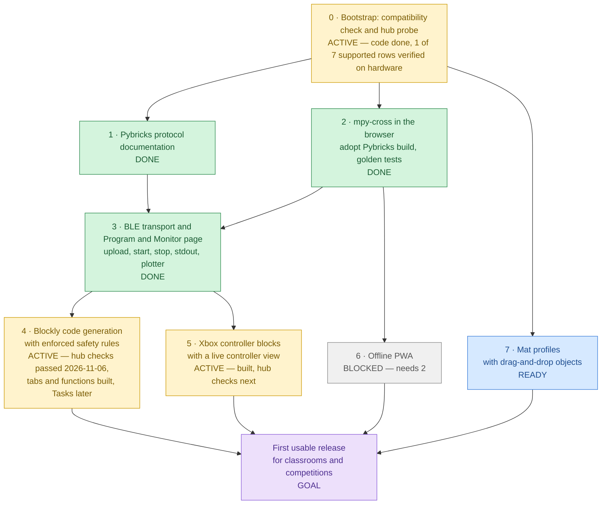

# Roadmap

Last reviewed: 2026-11-06

## At a glance

Milestone numbers are the planned order of work. Arrows are hard technical dependencies: a milestone
cannot be finished before the milestones that point to it.

| Milestone                        | Status     | What it is                                                                                                                                                                                                                                                                      | Blocker                                                                                                                                                                                                                                                                                                                                                                                                                        |
| -------------------------------- | ---------- | ------------------------------------------------------------------------------------------------------------------------------------------------------------------------------------------------------------------------------------------------------------------------------- | ------------------------------------------------------------------------------------------------------------------------------------------------------------------------------------------------------------------------------------------------------------------------------------------------------------------------------------------------------------------------------------------------------------------------------ |
| **0 · Bootstrap**                | 🟡 ACTIVE  | Static Next.js app, Docker toolchain, CI, docs, ADRs, compatibility check, read-only hub probe, hardware test page                                                                                                                                                              | Hardware verification of the other 6 supported rows (Chrome on macOS verified 2026-11-04; [checklist](compatibility.md#how-to-verify-a-row-on-hardware))                                                                                                                                                                                                                                                                       |
| **1 · Pybricks protocol docs**   | ✅ DONE    | [`docs/protocol/pybricks-ble.md`](protocol/pybricks-ble.md): capabilities, commands, events, program format and upload sequence, every statement cited to an upstream commit                                                                                                    | —                                                                                                                                                                                                                                                                                                                                                                                                                              |
| **2 · mpy-cross in the browser** | ✅ DONE    | Adopt Pybricks' `@pybricks/mpy-cross-v6` WebAssembly build ([ADR 0006](adr/0006-adopt-pybricks-mpy-cross.md)); golden tests prove byte-for-byte identical output to `pybricksdev` for the same source                                                                           | — (goldens byte-identical; the `.wasm` loads from this site under the CSP)                                                                                                                                                                                                                                                                                                                                                     |
| **3 · BLE transport**            | ✅ DONE    | Upload a compiled program, start and stop it, stream stdout, in `src/lib/ble/`; Program and Monitor page with text monitor and plotter                                                                                                                                          | — (9 of 9 [hardware checks](compatibility.md#program-and-monitor-results) passed 2026-11-05)                                                                                                                                                                                                                                                                                                                                   |
| **4 · Blockly code generation**  | 🟡 ACTIVE  | `/blocks` ([ADR 0008](adr/0008-block-editor.md)): Blockly editor that generates Pybricks MicroPython and enforces the hub code rules (`try`/`finally` motor stop, config block, no hardcoded ports); tabs of functions become Python files ([ADR 0013](adr/0013-block-tabs.md)) | Hardware checks passed 2026-11-06, and the undo, save and load checks too ([results](compatibility.md#blocks-results)). Tabs and functions are built ([ADR 0013](adr/0013-block-tabs.md)); the maintainer tried their first [checks](compatibility.md#tabs-and-functions-checks-milestone-4), copy and paste between tabs and shared variables followed, and the hub checks are next. Left: Tasks (an `await`-aware generator) |
| **5 · Xbox controller**          | 🟡 ACTIVE  | Controller blocks: the hub reads an Xbox controller (hub-direct, [ADR 0003](adr/0003-hub-direct-gamepad.md)) and the page shows it live ([ADR 0012](adr/0012-controller-blocks.md))                                                                                             | The [controller blocks checks](compatibility.md#controller-blocks-checks-milestone-5) on a hub. The first check (2026-11-06) suggests the link to the page holds. Xbox only                                                                                                                                                                                                                                                    |
| **6 · Offline PWA**              | ⬜ BLOCKED | Service worker and manifest so the app, including the WebAssembly compiler, works without a network                                                                                                                                                                             | Needs 2 (the compiler must be cacheable to compile offline)                                                                                                                                                                                                                                                                                                                                                                    |
| **7 · Mat profiles**             | 🔵 READY   | Mat profiles with drag-and-drop objects, all in millimetres ([ADR 0004](adr/0004-millimetre-units.md))                                                                                                                                                                          | None technically; scheduled last by priority                                                                                                                                                                                                                                                                                                                                                                                   |
| **Goal: first usable release**   | 🟪 GOAL    | Students program a robot with blocks, run it on a hub, drive it with a controller, and use the app offline                                                                                                                                                                      | Needs 4, 5, 6 and 7                                                                                                                                                                                                                                                                                                                                                                                                            |

**The real bottleneck is hardware access.** Hardware verification (a real SPIKE Prime hub on each
supported browser and platform) gates milestone 0 and every BLE feature; it cannot be replaced by
unit tests. Milestone 3, the only join on the critical path, is done (verified on a hub
2026-11-05). Milestone 4's blocks, layout and live values passed their hardware checks on
2026-11-06; undo, save and load are built and passed their checks. Tabs and functions (a program
in several Python files) are built; the maintainer tried the first checks without a hub, and copy
and paste between tabs and shared variables were added from that. The checks that run such a
program on a hub for the first time wait for the hardware. Milestone 5 has its controller blocks and live view built; they wait for
their hardware checks. The first controller check suggests the hub keeps its link to the page while it uses the
controller.

## Milestones in planned order

### 0 · Bootstrap (this release)

Repository, CI, documentation, ADRs, and the first feature: a compatibility check and a read-only
hub probe that reads the device name, firmware revision, and protocol version. A hardware test page
(`/hardware-test`) guides the hardware checks and produces a report. Verified so far: Google Chrome
on macOS (2026-11-04, Pybricks 4.0.1, all five steps). Remaining: the other six supported rows
(Chrome and Edge on Windows, Edge on macOS, Chrome on ChromeOS, Chrome and Edge on Android),
recorded in [compatibility.md](compatibility.md).

### 1 · Pybricks protocol documentation (done)

[`docs/protocol/pybricks-ble.md`](protocol/pybricks-ble.md) describes every part of the Pybricks BLE
protocol MatPilot uses (capabilities, commands, events, status flags, the program format, and the
upload sequence). Each statement has a permalink to the upstream source at Pybricks v4.0.1 and
pybricksdev v2.3.2, and the protocol version each feature first appeared in.

### 2 · mpy-cross in the browser with golden tests

Adopt Pybricks' published WebAssembly build of the MicroPython cross-compiler,
`@pybricks/mpy-cross-v6`, served from MatPilot's own origin
([ADR 0006](adr/0006-adopt-pybricks-mpy-cross.md)). Golden tests compile a corpus of programs with
both the browser build and `pybricksdev`, and require byte-for-byte identical output.

### 3 · BLE transport, and the Program and Monitor page (done)

Upload, start, stop, stdin, and stdout over Web Bluetooth, framework-agnostic in `src/lib/ble/`,
with unit tests against fake GATT objects and an on-hardware test checklist. This is the first code
that writes to the hub, so it starts with its own design ADR. The first user of it is a "Program
and Monitor" page: a Python editor with Run and Stop, a text monitor for the program's output (like
Arduino's Serial Monitor), and a live plotter for printed numbers (like its Serial Plotter).

### 4 · Blockly code generation with enforced safety rules

The block editor and Python generator ([ADR 0008](adr/0008-block-editor.md)), on `/blocks`. The
generator guarantees the hub code rules in [CLAUDE.md](../CLAUDE.md) structurally, so a block
program cannot omit them.

- **First block set (built 2026-11-05):**
  - Setup: motors, colour, distance and touch sensors by name and port.
  - Output: motor moves, hub light, display and beep.
  - Input: motor, sensor, hub button, tilt, timer.
  - Flow, Data, Variables, and Other (print and plot).
- **Full-window layout and live device values (built 2026-11-05, after the first run on a hub):**
  the blocks fill the window, Python opens beside them or fills the window, the Monitor and
  Plotter open in a drawer, and a device bar shows what is plugged into each port with live values
  ([ADR 0008](adr/0008-block-editor.md) amendment, [ADR 0009](adr/0009-live-device-values.md)).
- **Simple blocks with pictures (built 2026-11-05, asked for before the next hardware checks):**
  Movement, Motors, Light, Sound, Control, Sensors and Operators for beginners, choosing devices by
  port, with pictures to set ports, turns, steering, speeds and the 5×5 lights; the first set
  folds under **Advanced** ([ADR 0010](adr/0010-simple-blocks.md)). The starter program uses them.
- **Hardware checks passed (2026-11-06):** every simple, advanced, and layout and live values
  check ([results](compatibility.md#blocks-results)). The maintainer's child tried the simple blocks
  and liked them. Still open: which way a drawn picture appears on the hub's lights (simple check
  8).
- **Undo, Save and Load (built 2026-11-06, asked for after the checks):** undo and redo buttons;
  Save and Load as a file on this computer, or in a GitHub repository a team shares, without
  silently replacing a teammate's newer version; opening a program and Start over are one undo
  step each ([ADR 0011](adr/0011-save-load-github.md),
  [checks](compatibility.md#undo-save-and-load-checks-milestone-4), all passed 2026-11-06).
- **Tabs and functions (built 2026-11-06, asked for while the controller checks wait for the
  hardware):** blocks of your own (define, call, inputs) and tabs like a browser's; each tab with
  functions becomes a Python file that main imports, with the ports and devices in `setup.py`
  ([ADR 0013](adr/0013-block-tabs.md),
  [checks](compatibility.md#tabs-and-functions-checks-milestone-4): 1 to 5 tried by the
  maintainer without a hub; the hub ones wait). Opening a program, Start over, closing a tab and
  moving a function are undone from the notice that appears, no longer with ↶ (this replaces part
  of ADR 0011). After the first try, the same day: copy and paste between tabs, a cut and pasted
  function that keeps its calls, and shared variables (🌐) for a value every tab needs (ADR 0013
  decisions 10 and 11).
- **Next:** milestone 5 comes first, by the maintainer's choice (2026-11-06). Then Tasks
  (`multitask`), which need an `await`-aware generator, and with them event blocks such as "when
  the colour sensor sees red"; then examples.
- **Later:** live values while the user's program runs. The reader cannot run beside the user's
  program; the program would report them itself, which needs the same `await`-aware generator.

### 5 · Xbox controller blocks with a live controller view

The hub reads an Xbox controller, and the page shows what it reads while the program runs. The
browser displays only; it is not in the control loop ([ADR 0003](adr/0003-hub-direct-gamepad.md)).
First planned as a test panel; the maintainer asked on 2026-11-06 for the controller in the
blocks instead, for children: sticks drive, buttons run motors, and it can be watched.

- **Controller blocks and the live view (built 2026-11-06,
  [ADR 0012](adr/0012-controller-blocks.md)):**
  - drive with the controller (one stick, tank, racing);
  - a motor runs with a button pair, a stick or the triggers;
  - button is pressed / was just pressed;
  - stick and trigger values;
  - rumble.
  - The program reports the controller in `@xbx` lines, which the page draws in a Controller
    pane, not in the Monitor. Menu stops the program; a lost controller stops every motor.
  - After the maintainer's review (same day): a "use the controller" choice with the
    controller's picture (Xbox only for now), buttons and sticks picked on the controller with the
    finger that reaches them, one block for several motors with a direction each, and a "Your
    controls" list in the pane.
  - [Checks](compatibility.md#controller-blocks-checks-milestone-5).
- **Next:** the hardware checks; then "when button pressed" hat blocks with Tasks (milestone 4's
  `await`-aware generator); reconnecting after the controller is lost.

**Controller choice (requested 2026-11-04).** The maintainer wants a choice of controller, for
example Xbox or PS4. **Answered 2026-11-05: the maintainer has an Xbox controller, and PS4 is not
needed for now.** Milestone 5 therefore builds the Xbox path only; the PS4 notes below stay as
the record of what a PS4 path would need.

- An Xbox controller connects to the hub directly ([ADR 0003](adr/0003-hub-direct-gamepad.md)).
- `PlayStationController` exists in Pybricks v4.1.2, but it is enabled only for EV3. It is off
  for SPIKE Prime
  ([`bricks/primehub_f4/mpconfigport.h#L36`](https://github.com/pybricks/pybricks-micropython/blob/511f6c20fb70d9d8951a85a50c383064747d5bc0/bricks/primehub_f4/mpconfigport.h#L36),
  [`bricks/ev3/mpconfigport.h#L38`](https://github.com/pybricks/pybricks-micropython/blob/511f6c20fb70d9d8951a85a50c383064747d5bc0/bricks/ev3/mpconfigport.h#L38)).
- A PS4 controller would therefore connect to the computer, and the page would pass its input on
  to the hub. That puts the browser in the control loop, against ADR 0003, so it needs its own
  ADR first. Its hub program would stop the motors when input stops arriving.

**Starting point (researched 2026-11-06).** The maintainer drove motors with an Xbox controller
from Python before, in
[lego-spike-prime-remote-car](https://github.com/lumduan/lego-spike-prime-remote-car) (commit
`798160126be916d92472ebcb14b7bac9b629e948`, `bench/04_tank_drive.py`): arcade and tank mixing,
`Motor.dc()`, a speed scale, expo, a slew limit and a minimum duty. Its notes record what milestone
5 must answer first:

- **The link to the computer may drop.** On 2026-08-28 the maintainer's SPIKE Prime hub (Pybricks
  4.0.1, driven by `pybricksdev`; computer OS not recorded) dropped its Bluetooth link to the
  computer as soon as a program began searching for the controller, so `print()` output never
  arrived (that repository's `ROADMAP.md`, the "Prime Hub drops its Bluetooth connection" row).
- **The firmware source does not explain it.**
  - The option to disconnect from the computer exists on the Technic Hub only
    ([`pb_type_iodevices_xbox_controller.c#L463-L471`](https://github.com/pybricks/pybricks-micropython/blob/4104553405decb0384bcfb030fbfcb4b5a9854cc/pybricks/iodevices/pb_type_iodevices_xbox_controller.c#L463-L471)).
  - The SPIKE Prime's Bluetooth stack allows two host connections and two peripherals
    ([`prime_hub/pbdrvconfig.h#L30-L33`](https://github.com/pybricks/pybricks-micropython/blob/4104553405decb0384bcfb030fbfcb4b5a9854cc/lib/pbio/platform/prime_hub/pbdrvconfig.h#L30-L33)).
  - While the hub searches for the controller, its Bluetooth loop waits for the search to finish
    before it sends the next notification, such as program output
    ([`bluetooth.c#L644-L670`](https://github.com/pybricks/pybricks-micropython/blob/4104553405decb0384bcfb030fbfcb4b5a9854cc/lib/pbio/drv/bluetooth/bluetooth.c#L644-L670)).
- **So the first step of milestone 5 is a hardware check with MatPilot's own connection:** start a
  program that connects the controller and prints its sticks, and see whether the output keeps
  arriving. Record which sign "stick up" gives in the same run; the operator's script leaves it as
  a constant because the documentation does not say.
  - **Built 2026-11-06:** the example **Xbox controller check (no motors)** on `/program`, and its
    [checklist](compatibility.md#xbox-controller-check-milestone-5). Its lights also show which
    way up the hub's 5×5 lights are, the question simple check 8 left open.
  - **Run 2026-11-06 ([results](compatibility.md#xbox-controller-check-results)):** the controller
    connected, and the hub's Bluetooth light stayed blue, which in Pybricks v4.0.1 means a
    computer is connected. So the link most likely held, unlike the 2026-08 `pybricksdev` run.
    The stick sign and the lights' top side were not reported; the controller blocks' checks
    show both.
- If the link drops, the "live telemetry in the browser" part of this milestone, and
  [ADR 0003](adr/0003-hub-direct-gamepad.md)'s note that the browser displays telemetry, need a
  new decision by the maintainer. The hub would still drive from the controller on its own.

### 6 · Offline PWA

Make the app installable and usable offline, including compilation. This milestone adds the service
worker that earlier milestones deliberately leave out.

### 7 · Mat profiles with drag-and-drop objects

Describe competition and practice mats and place objects on them, all in millimetres.

## Keeping this roadmap current

Any change that completes or materially advances a milestone must update this file in the same pull
request: the diagram node text and class, the table row, the bottleneck statement if it changed, and
the "Last reviewed" date. A roadmap that disagrees with the code is a bug.
