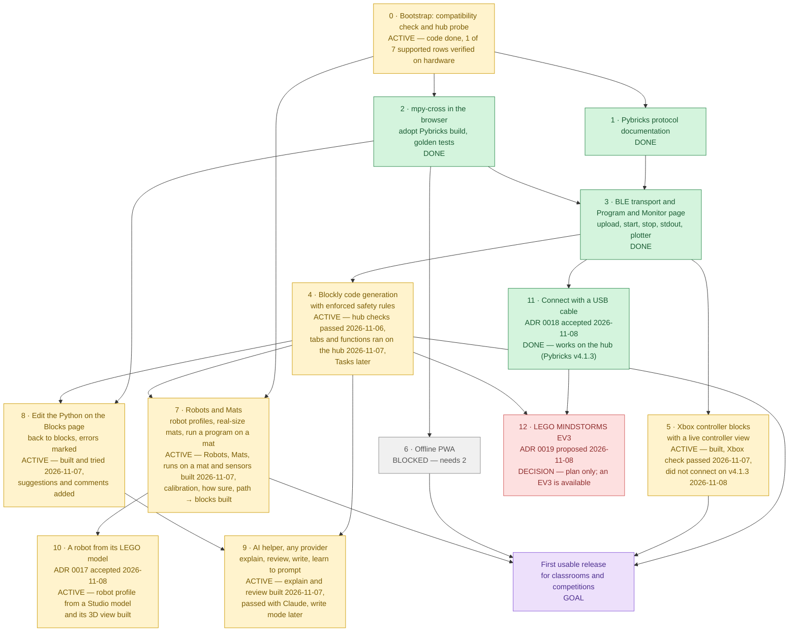

# Roadmap

Last reviewed: 2026-11-08

## At a glance

Milestone numbers are the planned order of work. Arrows are hard technical dependencies: a milestone
cannot be finished before the milestones that point to it.

| Milestone                        | Status      | What it is                                                                                                                                                                                                                                                                      | Blocker                                                                                                                                                                                                                                                                                                                                                                                                                                                                                                                       |
| -------------------------------- | ----------- | ------------------------------------------------------------------------------------------------------------------------------------------------------------------------------------------------------------------------------------------------------------------------------- | ----------------------------------------------------------------------------------------------------------------------------------------------------------------------------------------------------------------------------------------------------------------------------------------------------------------------------------------------------------------------------------------------------------------------------------------------------------------------------------------------------------------------------- |
| **0 · Bootstrap**                | 🟡 ACTIVE   | Static Next.js app, Docker toolchain, CI, docs, ADRs, compatibility check, read-only hub probe, hardware test page                                                                                                                                                              | Hardware verification of the other 6 supported rows (Chrome on macOS verified 2026-11-04; [checklist](compatibility.md#how-to-verify-a-row-on-hardware))                                                                                                                                                                                                                                                                                                                                                                      |
| **1 · Pybricks protocol docs**   | ✅ DONE     | [`docs/protocol/pybricks-ble.md`](protocol/pybricks-ble.md): capabilities, commands, events, program format and upload sequence, every statement cited to an upstream commit                                                                                                    | —                                                                                                                                                                                                                                                                                                                                                                                                                                                                                                                             |
| **2 · mpy-cross in the browser** | ✅ DONE     | Adopt Pybricks' `@pybricks/mpy-cross-v6` WebAssembly build ([ADR 0006](adr/0006-adopt-pybricks-mpy-cross.md)); golden tests prove byte-for-byte identical output to `pybricksdev` for the same source                                                                           | — (goldens byte-identical; the `.wasm` loads from this site under the CSP)                                                                                                                                                                                                                                                                                                                                                                                                                                                    |
| **3 · BLE transport**            | ✅ DONE     | Upload a compiled program, start and stop it, stream stdout, in `src/lib/ble/`; Program and Monitor page with text monitor and plotter                                                                                                                                          | — (9 of 9 [hardware checks](compatibility.md#program-and-monitor-results) passed 2026-11-05)                                                                                                                                                                                                                                                                                                                                                                                                                                  |
| **4 · Blockly code generation**  | 🟡 ACTIVE   | `/blocks` ([ADR 0008](adr/0008-block-editor.md)): Blockly editor that generates Pybricks MicroPython and enforces the hub code rules (`try`/`finally` motor stop, config block, no hardcoded ports); tabs of functions become Python files ([ADR 0013](adr/0013-block-tabs.md)) | Hardware checks passed 2026-11-06, and the undo, save and load checks too ([results](compatibility.md#blocks-results)). Tabs and functions are built ([ADR 0013](adr/0013-block-tabs.md)); the maintainer tried their first [checks](compatibility.md#tabs-and-functions-checks-milestone-4), copy and paste between tabs and shared variables followed, and the hub checks passed 2026-11-07. Left: Tasks (an `await`-aware generator)                                                                                       |
| **5 · Xbox controller**          | 🟡 ACTIVE   | Controller blocks: the hub reads an Xbox controller (hub-direct, [ADR 0003](adr/0003-hub-direct-gamepad.md)) and the page shows it live ([ADR 0012](adr/0012-controller-blocks.md))                                                                                             | The [controller blocks checks](compatibility.md#controller-blocks-checks-milestone-5) on a hub. The Xbox check (2026-11-07) showed that the link to the page holds, and the controller blocks were tried on the hub the same day with no failure reported. On v4.1.3 (2026-11-08) the controller did not connect, reason not reported; the hub now shows the search (blinking blue, green and beeps) and the Monitor gives the hub's reason ([ADR 0012](adr/0012-controller-blocks.md) amendment, checks 12 to 15). Xbox only |
| **6 · Offline PWA**              | ⬜ BLOCKED  | Service worker and manifest so the app, including the WebAssembly compiler, works without a network                                                                                                                                                                             | Needs 2 (the compiler must be cacheable to compile offline)                                                                                                                                                                                                                                                                                                                                                                                                                                                                   |
| **7 · Robots and Mats**          | 🟡 ACTIVE   | Robots page (profiles: size, wheels, motors, sensors, speed), Mats page (a PDF or picture at real size, place and measure the robot), and running a block program on a mat in the page ([ADR 0016](adr/0016-robots-and-mats.md), accepted)                                      | 7a (Robots), 7b (Mats, with GitHub), 7c (running a program on a mat) and 7d (sensors read the mat) built 2026-11-07; the Mats checks passed with the real WRO PDF; the [Robots](compatibility.md#robots-checks-milestone-7) and [run](compatibility.md#running-a-program-on-a-mat-milestone-7) checks are the maintainer's; the calibration helper (measure on the floor), how sure a run is (the spread from the robot's drift) and a path drawn on the mat → blocks built 2026-11-07/08; the part builder is milestone 10   |
| **8 · Python editing**           | 🟡 ACTIVE   | Edit a tab's Python on `/blocks`; it goes back to blocks only when correct, with errors marked where they are; suggestions with help, and comments kept ([ADR 0014](adr/0014-python-editing-on-blocks-page.md))                                                                 | Tried 2026-11-07; suggestions, help and comments added the same day ([checks](compatibility.md#python-editing-checks-milestone-8) 10 to 12)                                                                                                                                                                                                                                                                                                                                                                                   |
| **9 · AI helper**                | 🟡 ACTIVE   | Explain, review and write code with any AI provider, and learn to prompt ([ADR 0015](adr/0015-ai-helper.md))                                                                                                                                                                    | Explain and review are built; the [checks](compatibility.md#ai-helper-checks-milestone-9) with a real key passed with Claude on 2026-11-07, DeepSeek not tried yet. Left: the write mode, which uses 8                                                                                                                                                                                                                                                                                                                        |
| **10 · LEGO part builder**       | 🟡 ACTIVE   | A robot profile from a LEGO model built in BrickLink Studio and exported as LDraw: its size, wheels, motors and sensors, the ports picked by the child ([ADR 0017](adr/0017-lego-part-builder.md), accepted 2026-11-08: route A, import)                                        | Steps 10a-1 (read the model, make the profile) and 10a-2 (the 3D view) built 2026-11-08; [Robots check 10](compatibility.md#robots-checks-milestone-7), with a Studio export of the real robot, is the maintainer's; the note to LDraw.org (D5) is agreed, to be sent by the maintainer once matpilot.org is registered                                                                                                                                                                                                       |
| **11 · USB cable**               | ✅ DONE     | Connect with a USB cable as well as Bluetooth: the same commands and events over Web Serial ([ADR 0018](adr/0018-usb-connection.md), [protocol](protocol/pybricks-usb.md))                                                                                                      | — Built and tried on the hub 2026-11-08 after updating it to v4.1.3: works ([results](compatibility.md#usb-results), not itemised). The baseline moved to v4.1.3 the same day; the maintainer reports the main Bluetooth features work on it too                                                                                                                                                                                                                                                                              |
| **12 · LEGO MINDSTORMS EV3**     | 🟥 DECISION | A second hub type: EV3 bricks on Pybricks v4.1.1+, over USB (the same link as 11) and later Bluetooth Classic; EV3 blocks (screen, gyro, ports A–D and S1–S4) ([ADR 0019](adr/0019-ev3-support.md), proposed)                                                                   | The maintainer's decisions D1 and D3–D6; an EV3 is available (D2, answered 2026-11-08; it runs ev3dev now, so Pybricks v4 must go on it first)                                                                                                                                                                                                                                                                                                                                                                                |
| **Goal: first usable release**   | 🟪 GOAL     | Students program a robot with blocks, run it on a hub, drive it with a controller, and use the app offline                                                                                                                                                                      | Needs 4, 5, 6 and 7                                                                                                                                                                                                                                                                                                                                                                                                                                                                                                           |

**The real bottleneck is hardware access.** Hardware verification (a real SPIKE Prime hub on each
supported browser and platform) gates milestone 0 and every BLE feature; it cannot be replaced by
unit tests. Milestone 3, the only join on the critical path, is done (verified on a hub
2026-11-05). Milestone 4's blocks, layout and live values passed their hardware checks on
2026-11-06; undo, save and load are built and passed their checks. Tabs and functions (a program
in several Python files) are built; the maintainer tried the checks that need no hub, and copy
and paste between tabs and shared variables were added from that. The checks that run such a
program on a hub passed on 2026-11-07. Milestone 5 has its controller blocks and live view built; they wait for
their hardware checks. The Xbox check showed on 2026-11-07 that the hub keeps its link to the page while it uses the
controller. On 2026-11-08, after the hub moved to v4.1.3, the controller did not connect; the reason was not reported,
and the program now shows the search on the hub and prints the hub's own reason.

**Milestones 8 and 9 were asked for and decided on 2026-11-07**
([ADR 0014](adr/0014-python-editing-on-blocks-page.md), [ADR 0015](adr/0015-ai-helper.md)): 8 is
built and was tried; 9's explain and review are built and passed with Claude (DeepSeek not tried
yet), and its write mode comes later. Milestones 8 and 9 are not part of the first usable
release unless the maintainer says so.

**Milestone 11, the USB cable, was asked for, built and tried on the hub on 2026-11-08**
([ADR 0018](adr/0018-usb-connection.md)): the maintainer updated the hub to Pybricks v4.1.3, the
new tested baseline, and reports that USB and the main Bluetooth features work on it (not itemised
check by check).

**Milestone 7 is built in full (ADR 0016) and waits on real-world checks:** the robot measured or
calibrated on the floor, and runs on the real mat compared with the page. **Milestone 10 is being
built** ([ADR 0017](adr/0017-lego-part-builder.md), accepted 2026-11-08): its first step, a robot
profile from a Studio model, and its second, the model in 3D, wait on one real-world check (a
model of the real robot against a ruler). Asking LDraw.org (D5) is a courtesy, not a blocker: the
library's licence allows serving its files with attribution. The maintainer agreed on 2026-11-08 to
send the note from MatPilot's own site address, once matpilot.org is registered.

**Milestone 7, which the first release needs, was planned and accepted on 2026-11-07** as Robots
and Mats ([ADR 0016](adr/0016-robots-and-mats.md)); its steps 7a to 7d (the Robots and Mats
pages, running a program on a mat, sensors reading the mat) and three follow-ups (the calibration
helper, how sure a run is, a path drawn on the mat → blocks) were built on 2026-11-07/08.

## Milestones in planned order

### 0 · Bootstrap (this release)

Repository, CI, documentation, ADRs, and the first feature: a compatibility check and a read-only
hub probe that reads the device name, firmware revision, and protocol version. A hardware test page
(`/hardware-test`) guides the hardware checks and produces a report. Verified so far: Google Chrome
on macOS (2026-11-04, Pybricks 4.0.1, all five steps). Remaining: the other six supported rows
(Chrome and Edge on Windows, Edge on macOS, Chrome on ChromeOS, Chrome and Edge on Android),
recorded in [compatibility.md](compatibility.md).

**Home page and Docs (built 2026-11-08, asked for: "start the docs alongside, with lots of
pictures, because children understand pictures fast"):** the home page says what MatPilot is,
gets a hub started in four steps, explains putting Pybricks on the hub with Pybricks' own
installer (linked, not copied), and credits Pybricks at length. **Docs** (`/docs`, in the top bar
of every page) explain each page with screenshots whose numbered marks follow the pictures:
Get started, Blocks, Robots, Mats, For grown-ups and Credits. The Blocks page's introduction moved
there, so the blocks get the whole window. The pictures are retaken with
`scripts/docs-pictures/docs_pictures.py` after a change to a page they show.

**Every block and the Docs search (built 2026-11-08, asked for: "the Docs should explain every
block, what it is for and when to use it, in case some overlap", and "a search in the Docs").**
A Docs page, **Every block**, gives each block its words, what it does, when to use it, the
Python it makes and the blocks it is easy to mix up with (print or write, wait in seconds or
milliseconds, and eight more), from `src/lib/blocks/reference.ts`; a test fails when a toolbox
block has no entry or an entry's words, shape or Python differ from the real block. A search box
at the top of the Docs' menu finds any section or block; it reads the Docs pages from the site
the first time it is used, so it never needs its own list.

### 1 · Pybricks protocol documentation (done)

[`docs/protocol/pybricks-ble.md`](protocol/pybricks-ble.md) describes every part of the Pybricks BLE
protocol MatPilot uses (capabilities, commands, events, status flags, the program format, and the
upload sequence). Each statement has a permalink to the upstream source at Pybricks v4.0.1 and
pybricksdev v2.3.2, and the protocol version each feature first appeared in.

### 2 · mpy-cross in the browser with golden tests

Adopt Pybricks' published WebAssembly build of the MicroPython cross-compiler,
`@pybricks/mpy-cross-v6`, served from MatPilot's own origin
([ADR 0006](adr/0006-adopt-pybricks-mpy-cross.md)). Golden tests compile a corpus of programs with
both the browser build and `pybricksdev`, and require byte-for-byte identical output.

### 3 · BLE transport, and the Program and Monitor page (done)

Upload, start, stop, stdin, and stdout over Web Bluetooth, framework-agnostic in `src/lib/ble/`,
with unit tests against fake GATT objects and an on-hardware test checklist. This is the first code
that writes to the hub, so it starts with its own design ADR. The first user of it is a "Program
and Monitor" page: a Python editor with Run and Stop, a text monitor for the program's output (like
Arduino's Serial Monitor), and a live plotter for printed numbers (like its Serial Plotter).

### 4 · Blockly code generation with enforced safety rules

The block editor and Python generator ([ADR 0008](adr/0008-block-editor.md)), on `/blocks`. The
generator guarantees the hub code rules in [CLAUDE.md](../CLAUDE.md) structurally, so a block
program cannot omit them.

- **First block set (built 2026-11-05):**
  - Setup: motors, colour, distance and touch sensors by name and port.
  - Output: motor moves, hub light, display and beep.
  - Input: motor, sensor, hub button, tilt, timer.
  - Flow, Data, Variables, and Other (print and plot).
- **Full-window layout and live device values (built 2026-11-05, after the first run on a hub):**
  the blocks fill the window, Python opens beside them or fills the window, the Monitor and
  Plotter open in a drawer, and a device bar shows what is plugged into each port with live values
  ([ADR 0008](adr/0008-block-editor.md) amendment, [ADR 0009](adr/0009-live-device-values.md)).
- **Simple blocks with pictures (built 2026-11-05, asked for before the next hardware checks):**
  Movement, Motors, Light, Sound, Control, Sensors and Operators for beginners, choosing devices by
  port, with pictures to set ports, turns, steering, speeds and the 5×5 lights; the first set
  folds under **Advanced** ([ADR 0010](adr/0010-simple-blocks.md)). The starter program uses them.
- **Hardware checks passed (2026-11-06):** every simple, advanced, and layout and live values
  check ([results](compatibility.md#blocks-results)). The maintainer's child tried the simple blocks
  and liked them. Still open: which way a drawn picture appears on the hub's lights (simple check
  8).
- **Undo, Save and Load (built 2026-11-06, asked for after the checks):** undo and redo buttons;
  Save and Load as a file on this computer, or in a GitHub repository a team shares, without
  silently replacing a teammate's newer version; opening a program and Start over are one undo
  step each ([ADR 0011](adr/0011-save-load-github.md),
  [checks](compatibility.md#undo-save-and-load-checks-milestone-4), all passed 2026-11-06).
- **Tabs and functions (built 2026-11-06, asked for while the controller checks wait for the
  hardware):** blocks of your own (define, call, inputs) and tabs like a browser's; each tab with
  functions becomes a Python file that main imports, with the ports and devices in `setup.py`
  ([ADR 0013](adr/0013-block-tabs.md),
  [checks](compatibility.md#tabs-and-functions-checks-milestone-4): 1 to 7 and 11 to 15 tried
  by the maintainer, the hub ones, 6, 7 and 14, on 2026-11-07; 8 to 10 not reported). Opening a program, Start over, closing a tab and
  moving a function are undone from the notice that appears, no longer with ↶ (this replaces part
  of ADR 0011). After the first try, the same day: copy and paste between tabs, a cut and pasted
  function that keeps its calls, and shared variables (🌐) for a value every tab needs (ADR 0013
  decisions 10 and 11).
- **Searching the blocks (built 2026-11-08, asked for: a child could not find "wait"):** a search
  box at the top of the categories finds blocks by their words, other words ("sleep" for wait)
  and the Python they make ([ADR 0010 amendment](adr/0010-simple-blocks.md#amendment-2026-11-08-searching-the-blocks),
  [check 12](compatibility.md#simple-blocks-checks-milestone-4)).
- **Conditions and "switch on" (built 2026-11-08, asked for: the "if" blocks were hard to find):**
  a Conditions category with "if", "else if", "else", the questions they ask, and a "switch on"
  block that checks a colour or a number once and does the matching case
  ([ADR 0010 amendment](adr/0010-simple-blocks.md#amendment-2026-11-08-conditions-and-switch-on),
  [check 11](compatibility.md#simple-blocks-checks-milestone-4), not yet run on a hub).
- **Next:** milestone 5 comes first, by the maintainer's choice (2026-11-06). Then Tasks
  (`multitask`), which need an `await`-aware generator, and with them event blocks such as "when
  the colour sensor sees red"; then examples.
- **Later:** live values while the user's program runs. The reader cannot run beside the user's
  program; the program would report them itself, which needs the same `await`-aware generator.

### 5 · Xbox controller blocks with a live controller view

The hub reads an Xbox controller, and the page shows what it reads while the program runs. The
browser displays only; it is not in the control loop ([ADR 0003](adr/0003-hub-direct-gamepad.md)).
First planned as a test panel; the maintainer asked on 2026-11-06 for the controller in the
blocks instead, for children: sticks drive, buttons run motors, and it can be watched.

- **Controller blocks and the live view (built 2026-11-06,
  [ADR 0012](adr/0012-controller-blocks.md)):**
  - drive with the controller (one stick, tank, racing);
  - a motor runs with a button pair, a stick or the triggers;
  - button is pressed / was just pressed;
  - stick and trigger values;
  - rumble.
  - The program reports the controller in `@xbx` lines, which the page draws in a Controller
    pane, not in the Monitor. Menu stops the program; a lost controller stops every motor.
  - After the maintainer's review (same day): a "use the controller" choice with the
    controller's picture (Xbox only for now), buttons and sticks picked on the controller with the
    finger that reaches them, one block for several motors with a direction each, and a "Your
    controls" list in the pane.
  - [Checks](compatibility.md#controller-blocks-checks-milestone-5).
- **The hub shows the search (2026-11-08, [ADR 0012](adr/0012-controller-blocks.md) amendment).**
  The controller did not connect on v4.1.3, reason not reported. The maintainer asked for a
  blinking blue light while the hub looks, a steady green light and a beep once connected, and
  for a controller paired before to connect by itself. Built: the blinking, two rising beeps (as
  in the maintainer's car program), 30 s per attempt (about a minute), the hub's own reason in
  the Monitor, and words saying that after the first pairing the Xbox button is enough (Pybricks
  already reconnects such a controller and keeps it connected between runs). Checks 12 to 15.
- **Next:** the hardware checks; then "when button pressed" hat blocks with Tasks (milestone 4's
  `await`-aware generator); reconnecting after the controller is lost.

**Controller choice (requested 2026-11-04).** The maintainer wants a choice of controller, for
example Xbox or PS4. **Answered 2026-11-05: the maintainer has an Xbox controller, and PS4 is not
needed for now.** Milestone 5 therefore builds the Xbox path only; the PS4 notes below stay as
the record of what a PS4 path would need.

- An Xbox controller connects to the hub directly ([ADR 0003](adr/0003-hub-direct-gamepad.md)).
- `PlayStationController` exists in Pybricks v4.1.2, but it is enabled only for EV3. It is off
  for SPIKE Prime
  ([`bricks/primehub_f4/mpconfigport.h#L36`](https://github.com/pybricks/pybricks-micropython/blob/511f6c20fb70d9d8951a85a50c383064747d5bc0/bricks/primehub_f4/mpconfigport.h#L36),
  [`bricks/ev3/mpconfigport.h#L38`](https://github.com/pybricks/pybricks-micropython/blob/511f6c20fb70d9d8951a85a50c383064747d5bc0/bricks/ev3/mpconfigport.h#L38)).
- A PS4 controller would therefore connect to the computer, and the page would pass its input on
  to the hub. That puts the browser in the control loop, against ADR 0003, so it needs its own
  ADR first. Its hub program would stop the motors when input stops arriving.

**Starting point (researched 2026-11-06).** The maintainer drove motors with an Xbox controller
from Python before, in
[lego-spike-prime-remote-car](https://github.com/lumduan/lego-spike-prime-remote-car) (commit
`798160126be916d92472ebcb14b7bac9b629e948`, `bench/04_tank_drive.py`): arcade and tank mixing,
`Motor.dc()`, a speed scale, expo, a slew limit and a minimum duty. Its notes record what milestone
5 must answer first:

- **The link to the computer may drop.** On 2026-08-28 the maintainer's SPIKE Prime hub (Pybricks
  4.0.1, driven by `pybricksdev`; computer OS not recorded) dropped its Bluetooth link to the
  computer as soon as a program began searching for the controller, so `print()` output never
  arrived (that repository's `ROADMAP.md`, the "Prime Hub drops its Bluetooth connection" row).
- **The firmware source does not explain it.**
  - The option to disconnect from the computer exists on the Technic Hub only
    ([`pb_type_iodevices_xbox_controller.c#L463-L471`](https://github.com/pybricks/pybricks-micropython/blob/4104553405decb0384bcfb030fbfcb4b5a9854cc/pybricks/iodevices/pb_type_iodevices_xbox_controller.c#L463-L471)).
  - The SPIKE Prime's Bluetooth stack allows two host connections and two peripherals
    ([`prime_hub/pbdrvconfig.h#L30-L33`](https://github.com/pybricks/pybricks-micropython/blob/4104553405decb0384bcfb030fbfcb4b5a9854cc/lib/pbio/platform/prime_hub/pbdrvconfig.h#L30-L33)).
  - While the hub searches for the controller, its Bluetooth loop waits for the search to finish
    before it sends the next notification, such as program output
    ([`bluetooth.c#L644-L670`](https://github.com/pybricks/pybricks-micropython/blob/4104553405decb0384bcfb030fbfcb4b5a9854cc/lib/pbio/drv/bluetooth/bluetooth.c#L644-L670)).
- **So the first step of milestone 5 is a hardware check with MatPilot's own connection:** start a
  program that connects the controller and prints its sticks, and see whether the output keeps
  arriving. Record which sign "stick up" gives in the same run; the operator's script leaves it as
  a constant because the documentation does not say.
  - **Built 2026-11-06:** the example **Xbox controller check (no motors)** on `/program`, and its
    [checklist](compatibility.md#xbox-controller-check-milestone-5). Its lights also show which
    way up the hub's 5×5 lights are, the question simple check 8 left open.
  - **Run 2026-11-06 ([results](compatibility.md#xbox-controller-check-results)):** the controller
    connected, and the hub's Bluetooth light stayed blue, which in Pybricks v4.0.1 means a
    computer is connected. So the link most likely held, unlike the 2026-08 `pybricksdev` run.
    The stick sign and the lights' top side were not reported; the controller blocks' checks
    show both. (➡️ Both answered the next day, see the next point.)
  - **Run 2026-11-07 ([results](compatibility.md#xbox-controller-check-results)):** passed. The
    program's output kept arriving while the controller was connected, so the link holds; the
    top of the 5×5 lights is the end with ports A and B; pushing the stick away gives a positive
    `left_y` (reported as passed). Pairing the controller took several tries.
- (➡️ Not needed: the link held on 2026-11-07.) If the link drops, the "live telemetry in the browser" part of this milestone, and
  [ADR 0003](adr/0003-hub-direct-gamepad.md)'s note that the browser displays telemetry, need a
  new decision by the maintainer. The hub would still drive from the controller on its own.

### 6 · Offline PWA

Make the app installable and usable offline, including compilation. This milestone adds the service
worker that earlier milestones deliberately leave out.

### 7 · Robots and Mats (accepted 2026-11-07; 7a to 7d built)

Asked for on 2026-11-07: **Robots** and **Mats** beside **Blocks** in the top bar. A robot has
clear dimensions, wheels, motors, sensors and speed; a mat is a real-size PDF or picture; a robot
made in Robots runs on a mat in Mats. The maintainer pointed at their earlier project
[lumduan/wro-2026](https://github.com/lumduan/wro-2026), whose mat frame, PDF size rule, geometry
and WRO rule quotes are reused. [ADR 0016](adr/0016-robots-and-mats.md), accepted with every
recommended option on 2026-11-07, plans it in steps:

1. 7a: the Robots page and robot profiles, and a program on `/blocks` that uses a robot;
2. 7b: the Mats page: upload a PDF or picture at real size, view, place the robot, measure;
3. 7c: run a block program on the mat: the same Python as the hub, run by MicroPython in the
   page with a simulated Pybricks, played back on the mat;
4. 7d: the colour sensor reads the mat.

Later in ADR 0016: the calibration helper, how sure the robot is (drift), and a path drawn on the
mat turned into blocks.

7a was built on 2026-11-07: the Robots page (profiles, a drawing to scale, speeds by the
firmware's cited rules, the turning circle, WRO 2026 checks, robot files) and the **Robot** choice
on `/blocks`, which sets the drive base of the program. Its
[checks](compatibility.md#robots-checks-milestone-7) are the maintainer's. 7b followed the same
day: the Mats page (a PDF at real size from its trim box, drawn by self-hosted pdf.js, or a
picture with its size typed in; areas; the robot placed, moved and turned, with the start-area
check; a ruler; mat files), with its own [checks](compatibility.md#mats-checks-milestone-7), which
passed with the real WRO 2026 PDF; GitHub Load and Save followed on every page. 7c, running a
program on a mat (its own Python in MicroPython in the page, played back on the mat), was built
the same day, and 7d too: the colour sensor reads the mat's picture by the firmware's cited
colour rules, and distance and touch sensors find the mat's edges and the solid objects marked on
it. The calibration helper followed: two short programs run from the Robots page, measured
with a tape measure, correct the wheel diameter and the axle track; then how sure a run is: 100
pretend runs from the robot's measured drift show where the real robot may end; and a path drawn
on the mat (click point by point) becomes "turn" and "move" blocks the Blocks page adds at the end
of main.
Building a robot from LEGO parts is milestone 10 ([ADR 0017](adr/0017-lego-part-builder.md)).

### 10 · Build a robot from LEGO parts (ADR 0017 accepted; steps 10a-1 and 10a-2 built 2026-11-08)

Asked for on 2026-11-07 as a future step: build the robot from parts, like BrickLink's tools, and
get its size, wheels and sensors from the model. It writes a robot profile (milestone 7), so
everything built for 7 keeps working. [ADR 0017](adr/0017-lego-part-builder.md), proposed
2026-11-08, holds the research (the LDraw part library: CC BY 4.0, about 147 MB, the SPIKE Prime
hub, motors, sensors and wheels all in it; BrickLink Studio exports LDraw) and recommends
importing a model exported from Studio, with a 3D view and the ports picked by the child, rather
than a builder of MatPilot's own. Accepted the same day ("continue with item 5, because it is a
very good feature"), and its first step built: on the Robots page, **Make from a LEGO model…**
reads a `.ldr` or `.mpd`, sizes every part from a table made from the whole LDraw library, finds
the drive wheels, the front, the drive motors (and which one is turned round), the other motors
and the sensors, and fills in the robot profile once the child has picked the ports. The robot
keeps its model. The second step followed the same day: the model drawn in 3D with three.js and
the SPIKE Prime and Technic parts' LDraw shapes, served from this site. Its
[check](compatibility.md#robots-checks-milestone-7) (10) needs a Studio export of the real robot.

### 8 · Edit the Python on the Blocks page (built 2026-11-07)

Asked for on 2026-11-07: edit a tab's Python on `/blocks` and turn it back into blocks; Python that
is wrong, or has no block, is marked in red where it is wrong and never replaces the blocks.
[ADR 0014](adr/0014-python-editing-on-blocks-page.md), accepted with every recommended option and
built the same day. Every block has a reader, kept in step with the generator by a test that reads
every toolbox block back. The maintainer tried the
[checks](compatibility.md#python-editing-checks-milestone-8) the same day and asked for
suggestions with help, and for comments that are kept; both were added (checks 10 to 12).

### 9 · AI helper with any provider (explain and review built 2026-11-07)

Asked for on 2026-11-07: AI that explains, reviews and writes code through an API, so that
children learn to prompt, and not tied to one provider (OpenAI, Anthropic, DeepSeek and others).
[ADR 0015](adr/0015-ai-helper.md), accepted with every recommended option: provider-neutral core,
bring-your-own key set by an adult, a fixed list of provider origins in the CSP, hint mode for
children, and every answer checked like a person's code. Explain and review need only 4; writing
code needs 8, so 9 cannot be finished before 8.

Built on 2026-11-07: the **AI helper** panel on `/blocks` with Explain and Review, for Anthropic,
OpenAI and DeepSeek through their official SDKs (loaded only when used), the adult's settings
(key, model from the provider's list, language, questions a day), the prompt checklist, "What the
AI sees", answers marked as from an AI with **Line N** links into the Python, tokens per answer,
and the prompt journal. Tested with a fake provider in the browser; the
[checks](compatibility.md#ai-helper-checks-milestone-9) with a real key are next. The write mode
is not built.

### 11 · Connect with a USB cable (ADR 0018; built and tried on the hub 2026-11-08)

Asked for on 2026-11-08: "besides Bluetooth, support connecting over USB too". Pybricks has a USB
link on SPIKE Prime from v4.1.0 (v4.1.1 fixed lost replies); MatPilot's tested v4.0.1 only charges
over USB. The hub is a USB serial port, so the page uses Web Serial; the commands and events are
the Bluetooth ones in COBS frames ([protocol](protocol/pybricks-usb.md)). A **USB** button beside
**Connect hub** (when the browser has Web Serial) connects over the cable; uploading, running,
stopping, input, live values and the calibration helper work the same way. Next: the maintainer
updates the hub with Pybricks' installer and runs the
[USB checks](compatibility.md#usb-connection-checks-milestone-11). The tested baseline moved to
v4.1.3 on 2026-11-08 (the maintainer's decision), with every firmware citation re-checked there;
the Bluetooth checks are to be run again on it. **Tried the same day:** the maintainer updated
the hub and reports that USB and the main Bluetooth features work on v4.1.3
([results](compatibility.md#usb-results)).

### 12 · LEGO MINDSTORMS EV3 (ADR 0019 proposed 2026-11-08)

Asked for on 2026-11-08 as a plan. Pybricks v4 runs natively on the EV3 (no SD card); over USB it
speaks exactly milestone 11's protocol, and over Bluetooth it is Classic RFCOMM, reached with Web
Serial after pairing in the operating system. Its Python differs (EV3Brick with a screen and no
IMU, ev3devices with gyro and infrared sensors, ports A–D and S1–S4), so EV3 programs need their
own blocks. [ADR 0019](adr/0019-ev3-support.md) proposes four steps (hub type and USB, EV3 blocks,
Bluetooth, the rest of the app) and lists the maintainer's decisions; nothing is built.

## Keeping this roadmap current

Any change that completes or materially advances a milestone must update this file in the same pull
request: the diagram node text and class, the table row, the bottleneck statement if it changed, and
the "Last reviewed" date. A roadmap that disagrees with the code is a bug.
