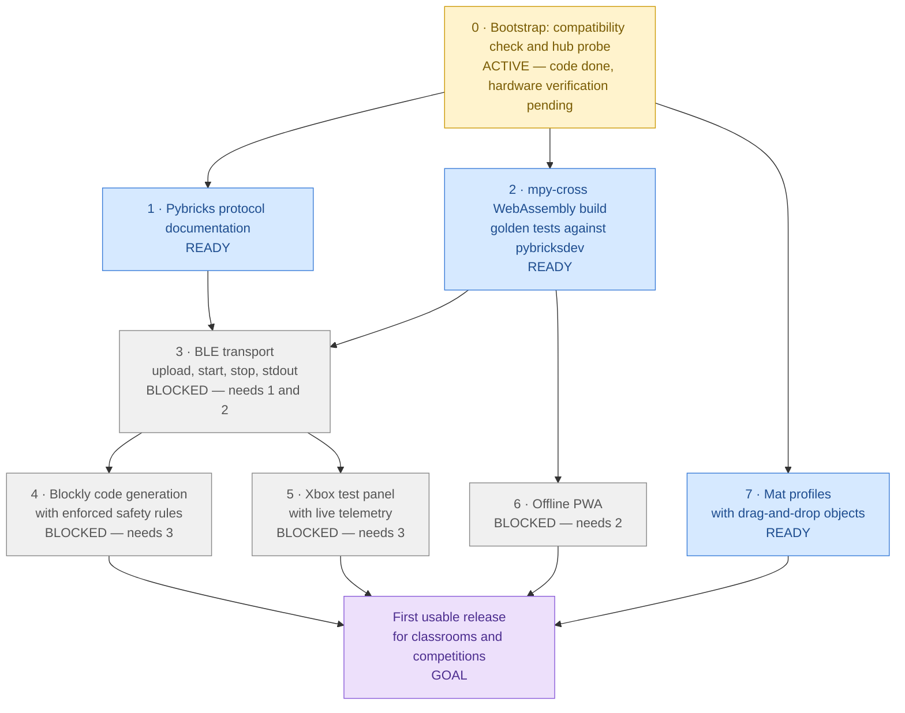

# Roadmap

Last reviewed: 2026-11-04

## At a glance

Milestone numbers are the planned order of work. Arrows are hard technical dependencies: a milestone
cannot be finished before the milestones that point to it.

| Milestone                       | Status     | What it is                                                                                                                                                            | Blocker                                                                                                              |
| ------------------------------- | ---------- | --------------------------------------------------------------------------------------------------------------------------------------------------------------------- | -------------------------------------------------------------------------------------------------------------------- |
| **0 · Bootstrap**               | 🟡 ACTIVE  | Static Next.js app, Docker toolchain, CI, docs, ADRs, compatibility check, read-only hub probe                                                                        | Hardware verification in Chrome/Edge with a real hub ([checklist](compatibility.md#how-to-verify-a-row-on-hardware)) |
| **1 · Pybricks protocol docs**  | 🔵 READY   | Document the Pybricks BLE protocol MatPilot needs (commands, events, program download, stdout), every statement cited to an upstream commit                           | None                                                                                                                 |
| **2 · mpy-cross WebAssembly**   | 🔵 READY   | Build MicroPython's `mpy-cross` to WebAssembly; golden tests prove byte-for-byte identical output to `pybricksdev` for the same source                                | None                                                                                                                 |
| **3 · BLE transport**           | ⬜ BLOCKED | Upload a compiled program, start it, stop it, and stream its stdout, in `src/lib/ble/`                                                                                | Needs **both** 1 (protocol details) **and** 2 (the payload it uploads)                                               |
| **4 · Blockly code generation** | ⬜ BLOCKED | Blockly editor that generates Pybricks MicroPython and enforces the hub code rules (`try`/`finally` motor stop, `OSError` handling, config block, no hardcoded ports) | Needs 3: the safety rules must be verified on a hub (for example, Stop really stops the motors)                      |
| **5 · Xbox test panel**         | ⬜ BLOCKED | Ships a hub program that reads an Xbox controller (hub-direct, [ADR 0003](adr/0003-hub-direct-gamepad.md)) and shows its live telemetry in the browser                | Needs 3 (upload and stdout). Independent of 4                                                                        |
| **6 · Offline PWA**             | ⬜ BLOCKED | Service worker and manifest so the app, including the WebAssembly compiler, works without a network                                                                   | Needs 2 (the compiler must be cacheable to compile offline)                                                          |
| **7 · Mat profiles**            | 🔵 READY   | Mat profiles with drag-and-drop objects, all in millimetres ([ADR 0004](adr/0004-millimetre-units.md))                                                                | None technically; scheduled last by priority                                                                         |
| **Goal: first usable release**  | 🟪 GOAL    | Students program a robot with blocks, run it on a hub, drive it with a controller, and use the app offline                                                            | Needs 4, 5, 6 and 7                                                                                                  |

**The real bottlenecks are hardware access and milestone 3.** Hardware verification (a real SPIKE
Prime hub on each supported browser and platform) gates milestone 0 now and every BLE milestone
later; it cannot be replaced by unit tests. Milestone 3 is the only join on the critical path:
everything that runs code on the hub waits for both the protocol documentation (1) and the compiler
(2). Milestones 1, 2, and 7 can proceed in parallel today.

## Milestones in planned order

### 0 · Bootstrap (this release)

Repository, CI, documentation, ADRs, and the first feature: a compatibility check and a read-only
hub probe that reads the device name, firmware revision, and protocol version. Remaining: verify the
acceptance checks on hardware and record the results in [compatibility.md](compatibility.md).

### 1 · Pybricks protocol documentation

A `docs/` page describing every part of the Pybricks BLE protocol MatPilot will use, with a permalink
to the upstream source (file, line, commit) for each statement, and the protocol version each feature
first appeared in. Ambiguities are listed as open questions instead of being guessed.

### 2 · mpy-cross WebAssembly build with golden tests

Build the MicroPython cross-compiler to WebAssembly and run it in the browser. Golden tests compile a
corpus of programs with both the WebAssembly build and `pybricksdev` and require byte-for-byte
identical output.

### 3 · BLE transport

Upload, start, stop, and stdout over Web Bluetooth, framework-agnostic in `src/lib/ble/`, with unit
tests against fake GATT objects and an on-hardware test checklist.

### 4 · Blockly code generation with enforced safety rules

The block editor and Python generator. The generator guarantees the hub code rules in
[CLAUDE.md](../CLAUDE.md) structurally, so a block program cannot omit them.

### 5 · Xbox test panel with live telemetry

A panel that uploads a controller test program and shows what the hub reports in real time. The
browser displays telemetry only; it is not in the control loop.

### 6 · Offline PWA

Make the app installable and usable offline, including compilation. This milestone adds the service
worker that earlier milestones deliberately leave out.

### 7 · Mat profiles with drag-and-drop objects

Describe competition and practice mats and place objects on them, all in millimetres.

## Keeping this roadmap current

Any change that completes or materially advances a milestone must update this file in the same pull
request: the diagram node text and class, the table row, the bottleneck statement if it changed, and
the "Last reviewed" date. A roadmap that disagrees with the code is a bug.
